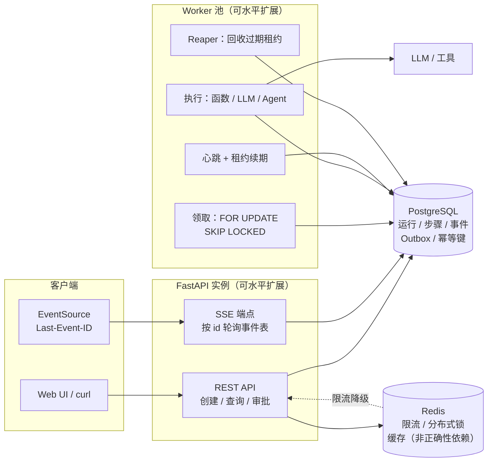
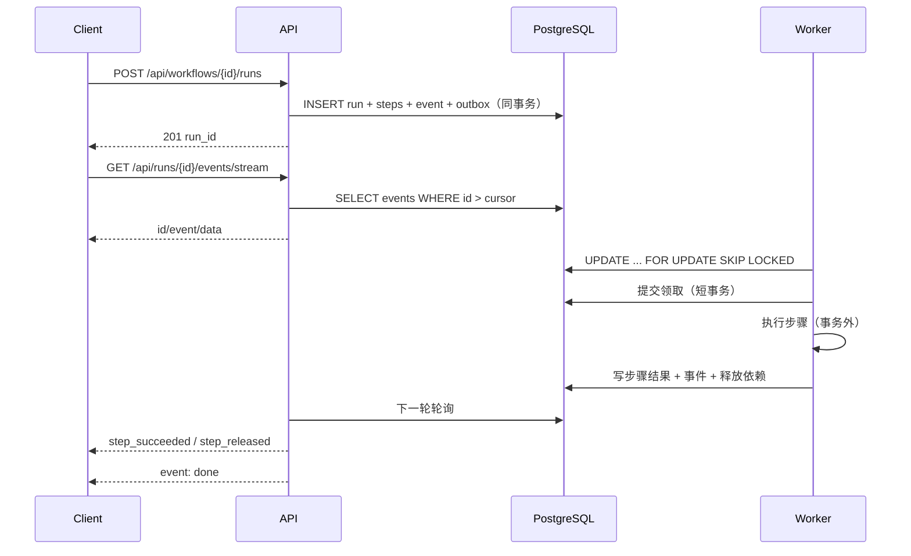
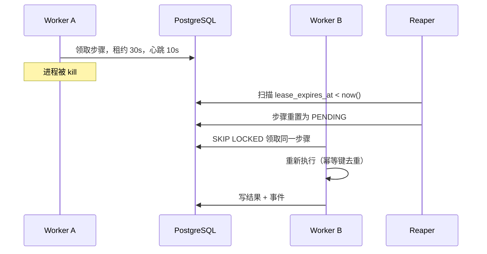
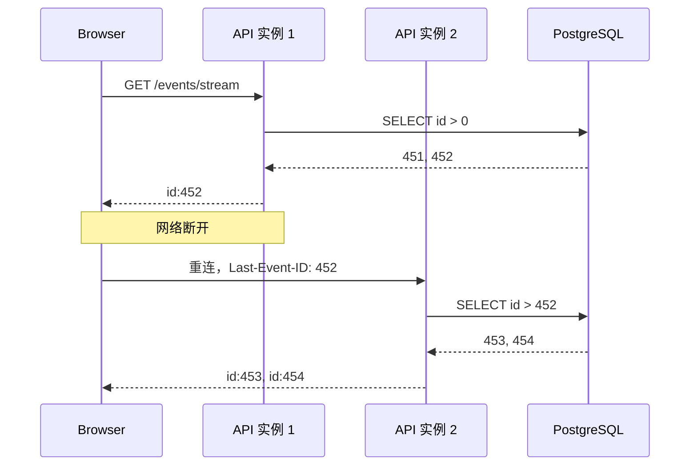
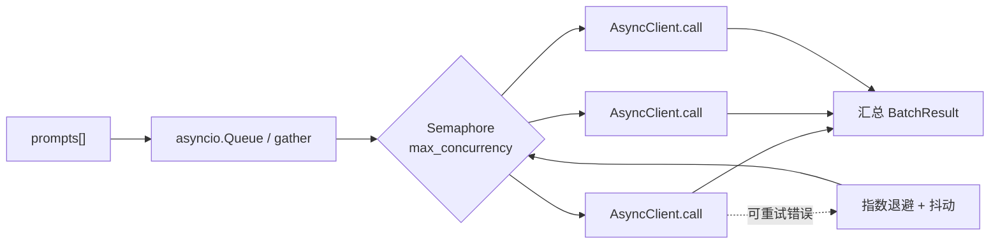

# DurableFlow 架构与关键链路

## 1. 组件图

关键点：

- PostgreSQL 是唯一事实来源；Redis 挂了不影响任务正确性。
- API 和 Worker 都可以多实例；领取靠数据库行锁，不靠 Redis 锁。
- SSE 端点只读事件表，不参与调度。

## 2. 一次运行的生命周期

## 3. 崩溃恢复

## 4. SSE 断线续传

换实例不影响续传：游标是数据库主键，不是内存状态。

## 5. 异步批量 LLM

- 信号量限制在途请求数，避免打爆上游 429。
- 退避期间释放信号量，不占并发槽。
- 单请求独立超时、独立重试；失败只影响自己。

## 6. 相关文档

- [SSE 细节与 Nginx 配置](sse.md)
- [技术选型取舍](tradeoffs.md)
- 项目证据表与评测计划：本地 `优化方案/05-项目证据与取舍.md`（不随仓库发布）
